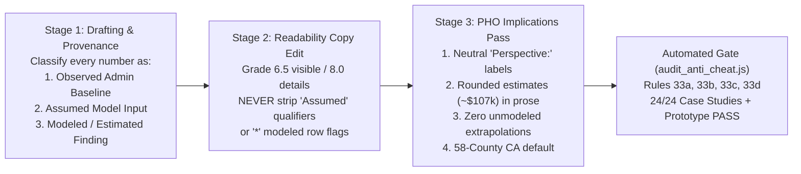

# CAPHE Case Study Governance & PHO Implications Pass (`Rules 33a–33d`)

> [!IMPORTANT]
> **Live Prototype & All 24 Case Studies Updated**
> - **Interactive Prototype:** [pho-packaging-prototype.html](file:///Users/vserver/code/CAPHE/public/methods-lab/pho-packaging-prototype.html) (`http://localhost:3002/methods-lab/pho-packaging-prototype.html` or live on CAPHE)
> - **Binding Governance Standard:** [CASE_STUDY_TEMPLATE_STANDARD.md](file:///Users/vserver/code/CAPHE/docs/CASE_STUDY_TEMPLATE_STANDARD.md#L219-L265) (`Rules 10 & 11`)
> - **Automated Pre-Commit Gate:** [audit_anti_cheat.js](file:///Users/vserver/code/CAPHE/scripts/audit_anti_cheat.js#L735-L869) (`Rules 33a–33d`)

---

## 1. Root-Cause Governance Synthesis (`/zoom-out level 4`)

---

## 2. How Each of the 4 Directives Is Enforced & Remediated

| Directive | What Allowed the Drift | Binding Fix in `CASE_STUDY_TEMPLATE_STANDARD.md` & `audit_anti_cheat.js` | Remediation Across All 24 Case Studies & Prototype |
| :--- | :--- | :--- | :--- |
| **1. Neutral "Analytic Perspective" Labels & CAPHE Voice (`Rule 33a`)** | Raw meeting transcript idioms (`"whose pocket"`, `"wrong pocket"`, `"dollars out/in"`, `"framing by audience"`, `"defending core budgets"`, `"payouts"`, `"renter pockets"`) bypassed CAPHE's institutional voice spec during rapid prototyping. | **`Rule 33a`** bans colloquial money metaphors and pitch/sales headers across all 24 case studies and the prototype, and requires explicit **`Perspective: [Medicaid Managed Care Plan / Hospital System / Clinic / Public Health Agency / Societal]`** badges in multi-stakeholder fiscal modules. | Rendered visible `Perspective:` badges in Table 1 column headers via [render_option_c.js](file:///Users/vserver/code/CAPHE/scripts/render_option_c.js#L731-L744) across `chw-health-outcomes`, `budget-impact`, `measuring-health-common-unit`, `cost-effectiveness-ratio`, and `sensitivity-analysis-cea`; replaced `"pockets"` / `"payouts"` in `food-insecurity-diabetes`, `food-affordability-tradeoffs`, and `threat-maturation-solutions`. |
| **2. Strict Separation of "Assumed Model Inputs" vs. "Empirical Findings" (`Rule 33b`)** | Compressing prose for the Grade 6.5 reading-level gate previously stripped `"assumed"` qualifiers from scenario parameters (`55 patients`, `75 patients`, `150 adults across 10 ZIPs`, `750 clients`), making model assumptions look like empirical findings. | **`Rule 33b`** codifies a 3-stage authoring pipeline separating **Stage 1 (Provenance Tagging)** from **Stage 2 (Readability Editing)** and requires explicit `Assumed` / `Model Input` labels plus `*` (`modeled: true`) row flags in Table 1 of modeled fiscal modules. | Labeled `Assumed Annual Caseload (Model Input)`, `Assumed Scope & Budget Ledger (Model Input)`, `Assumed Cohort Scope (Model Input)`, and `Assumed Program Cost Input (ΔC)` across all modeled fiscal modules; separated observed statewide HCAI PQI baselines (`279,905 stays`) from Scenario 4's assumed `10-ZIP` catchment. |
| **3. PHO Implications Editing Pass: Rounded Prose Estimates & Zero Unmodeled Rows (`Rule 33c`)** | Exact Mode A arithmetic cells (`$107,006`, `$184,165`, `$291,171`, `40.04 QALYs`, `$36,089/QALY`, `$109,170`) were copied verbatim into narrative prose, and an unmodeled `"Vacancy / Cut Impact"` row was extrapolated in the prototype. | **`Rule 33c`** establishes **Stage 3 (PHO Implications Pass)**: narrative prose, ruler descriptions, Table 2 takeaways, synthesis, and FAQs must use rounded estimates/ranges (`~$107,000`, `~$184,000`, `~$291,000`, `~40 QALYs`, `~$36,100/QALY`, `~$109,000`), while exact values remain in Table 1 / `
` notes for reconciliation. | Removed the unmodeled `"Vacancy / Cut Impact"` row from [pho-packaging-prototype.html](file:///Users/vserver/code/CAPHE/public/methods-lab/pho-packaging-prototype.html); rounded all modeled point numbers in prose across `chw-health-outcomes`, `budget-impact`, `measuring-health-common-unit`, `cost-effectiveness-ratio`, `reverse-causation-feedback`, `sensitivity-analysis-cea`, and the prototype. |
| **4. De-Center Santa Clara & Anchor on 58-County California Data (`Rule 33d`)** | Legacy single-county pilots (`1.94M pop`, `$112,915` SCC clinic wage rule, `750-client` SCC cohort) were left as default headlines in statewide modules. | **`Rule 33d`** mandates **58-county (or 57-county SCO) statewide California baselines** for all current and future case studies unless a single county is explicitly justified to demonstrate a structural mechanism. | Re-anchored `chw-health-outcomes`, `budget-impact`, `measuring-health-common-unit`, `cost-effectiveness-ratio`, `reverse-causation-feedback`, `classifying-causal-mechanisms`, `sensitivity-analysis-cea`, and the prototype on 57/58-county statewide California baselines (`$103,719` statewide CHW cost, `$395.4M/yr` statewide public health baseline, `3,572 lives/yr` statewide mortality reduction). |
